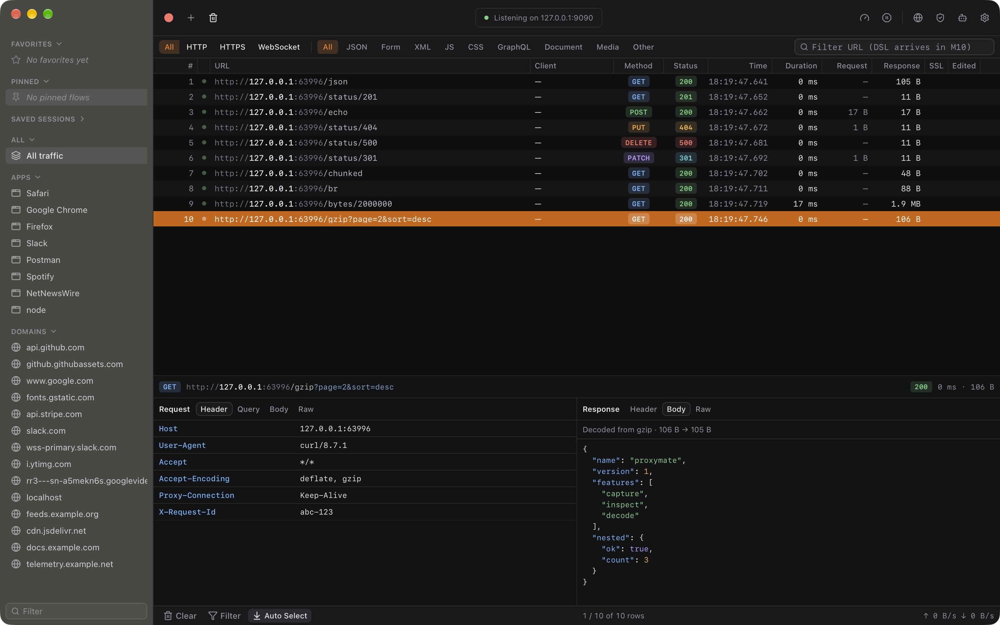

# Proxymate

A fast desktop HTTP(S) debugging proxy, built with Tauri 2, a Rust core and a React UI. macOS comes first, then Linux and Windows.

> Early development. As of M1, Proxymate is an HTTP/1.1 forward proxy on `127.0.0.1:9090` that records traffic live, with an inspector for headers, query, raw messages and decoded JSON bodies. HTTPS interception lands in M2. See [`docs/PLAN.md`](docs/PLAN.md) for the full plan and milestones.

```sh
npm install && npm run tauri dev
curl -x http://127.0.0.1:9090 http://example.com/
```



## Develop

Requirements:
- Rust (stable, edition 2024).
- Node 22 or newer, with npm.
- The [Tauri prerequisites](https://v2.tauri.app/start/prerequisites/) for your OS.

```bash
npm install
npm run tauri dev
```

See [`CLAUDE.md`](CLAUDE.md) for all commands, the crate layout and conventions.
