<p align="center">
  <picture>
    <source media="(prefers-color-scheme: dark)" srcset="brand/svg/proxymate-horizontal-white.svg">
    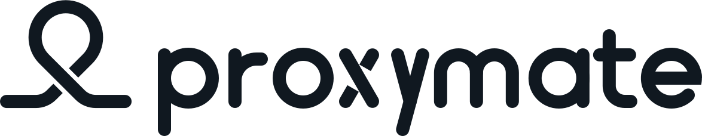
  </picture>
</p>

<p align="center">
  A fast desktop HTTP(S) debugging proxy, in the vein of Proxyman and Charles.<br>
  A Rust core, a React UI on Tauri 2, and a built-in MCP server so AI agents can work with your traffic too.
</p>

<p align="center">
  <a href="https://github.com/charlie-niekirk/proxymate/releases/latest">Download for macOS</a> ·
  <a href="#features">Features</a> ·
  <a href="#getting-started">Getting started</a> ·
  <a href="#develop">Develop</a> ·
  <a href="docs/PLAN.md">Plan</a>
</p>

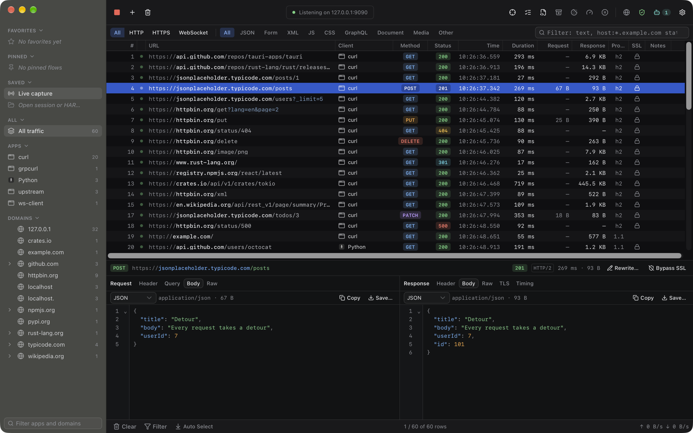

Proxymate records HTTP/1.1, HTTP/2, HTTPS, WebSocket, server-sent events and gRPC traffic. You can inspect it, filter it, rewrite it, pause it, replay it and mock it. It runs on macOS today. Linux and Windows are next on the [plan](docs/PLAN.md) (M12).

## Features

### Capture
- **HTTPS decryption** with its own certificate authority. TLS is MITM'd with ALPN mirrored, so HTTP/2 stays HTTP/2. A certificate wizard installs the CA and checks with a real handshake that it's trusted.
- **SSL Proxying lists** say which hosts to decrypt and which to tunnel. Pinned clients are detected and can be bypassed in one click.
- **System proxy** with one click. Your previous settings are backed up first, and a guardian process puts them back even if the app is killed with `kill -9`.
- **Every client app**, with its name and icon, in a sidebar grouped by Apps and Domains.
- **Intercepted launches** of Terminal, iTerm, Chrome, Edge, Brave, Arc and Firefox: they go through Proxymate and trust it without touching the system proxy or your keychain.
- **Devices**: one-click setup for the iOS Simulator, plus guided setup with QR codes for an iPhone, an Android phone and the Android emulator. LAN clients wait for an "Allow?" prompt.
- **Network plumbing**: chain to an upstream HTTP or SOCKS5 proxy (per host, with auth), take SOCKS5 clients on the same port, run reverse proxies, present client certificates (mTLS) and override DNS.
- **Recording lists** keep noisy hosts out of the capture. **Auto-save** writes the session to disk at an interval you choose.

### Inspect
- **A table built for big captures**: 100,000 rows scroll at 60 fps, and a filter change repaints in under 50 ms. Methods, statuses and URLs are colour-coded.
- **Search with a query language** (`host:*.example.com status:500 method:POST`), with autocomplete. Deep terms (`header:`, `body:`) search headers and decoded bodies on disk.
- **Body viewers** for JSON (pretty and tree), XML, HTML (with a sandboxed preview), forms, multipart, GraphQL, JavaScript, CSS, images, video, audio, PDF, fonts and hex. Compressed bodies are decoded for you.
- **Protobuf and gRPC**: gRPC and gRPC-web calls are split into messages, decoded with or without a `.proto` schema, and show their `grpc-status`. MessagePack and CBOR decode too.
- **WebSockets and SSE** stream live into their own panels.
- **TLS and Timing tabs** show the negotiated protocol, certificate chain and the route a request took.
- **Workflow**: multi-select, pins, labels, comments, extra header columns, Compare two flows, and ⌘K for every command.

<table>
  <tr>
    <td width="50%">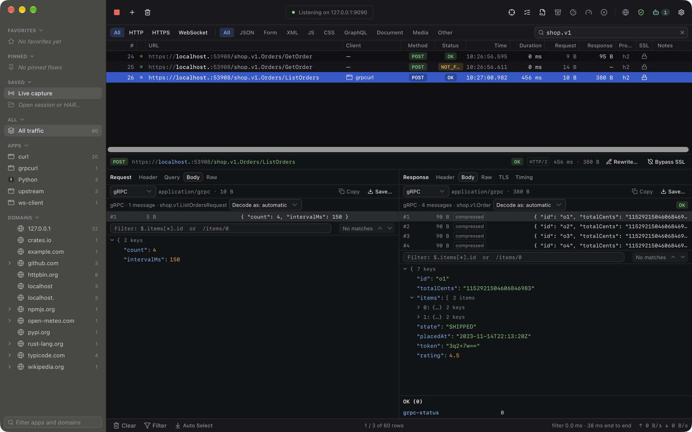</td>
    <td width="50%">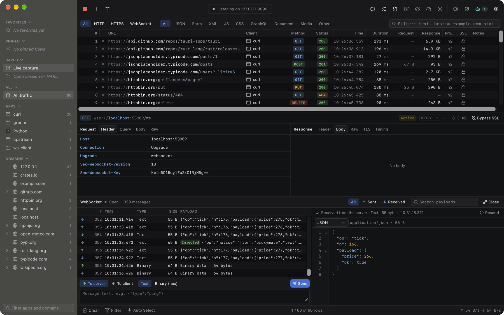</td>
  </tr>
  <tr>
    <td>gRPC decoded with a <code>.proto</code> schema, including a server stream</td>
    <td>A live WebSocket: search, inspect, send and inject messages</td>
  </tr>
  <tr>
    <td>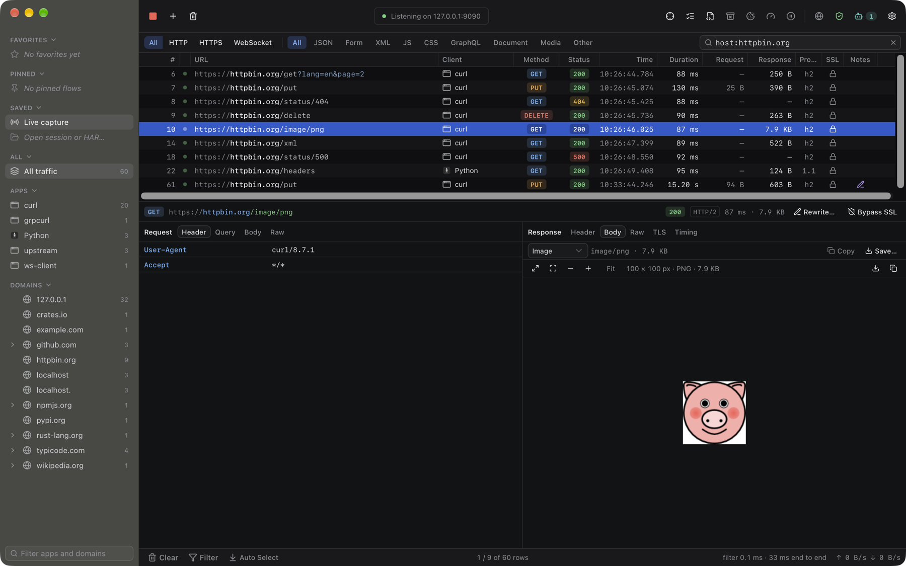</td>
    <td>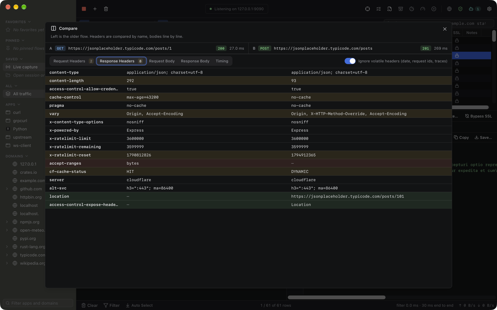</td>
  </tr>
  <tr>
    <td>Rich body previews and a host filter</td>
    <td>Compare two flows</td>
  </tr>
</table>

### Change traffic
- **One rules system.** A rule matches requests (method, scheme, host, path, query, headers, client app, even the response) and runs actions in order: Map Local, Map Remote, header, query and body rewrites, exact JSON edits, status changes, throttling, blocking and breakpoints. Right-click a flow to start a rule from a preset, and dry-run it against a captured flow before saving.
- **Visual rewrite.** Edit a captured request or response as a table or a JSON tree, and Proxymate saves a rule that patches only what you changed, leaving every other byte as it was.
- **Breakpoints** pause a request or response (or a WebSocket message) so you can edit it, answer it yourself, or abort it.
- **Scripts** in JavaScript (QuickJS, with no network or file access) decode bodies into extra views, rewrite traffic and mock responses.
- **WebSocket rules** rewrite, drop or delay messages, and you can send new ones from the UI.
- **No Caching** and **Block Cookies** are one toggle each in the toolbar.

<table>
  <tr>
    <td width="50%">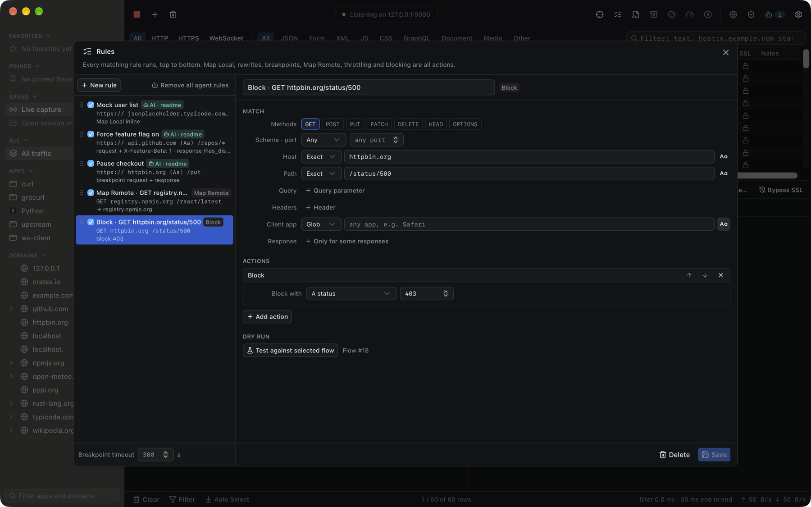</td>
    <td width="50%">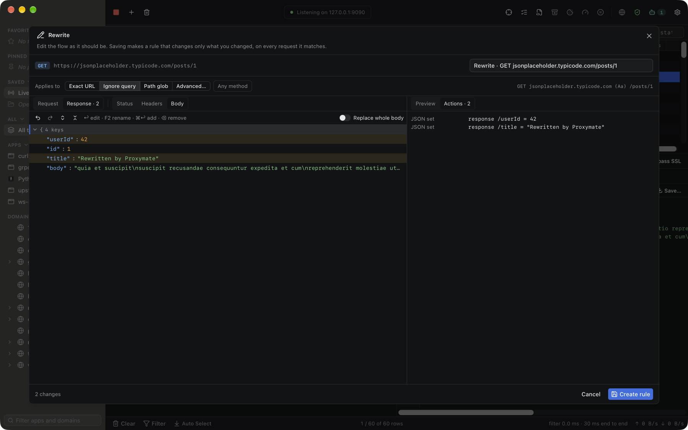</td>
  </tr>
  <tr>
    <td>Rules, including ones an AI agent made (tagged)</td>
    <td>Rewrite: edit the response, save only the changes</td>
  </tr>
  <tr>
    <td>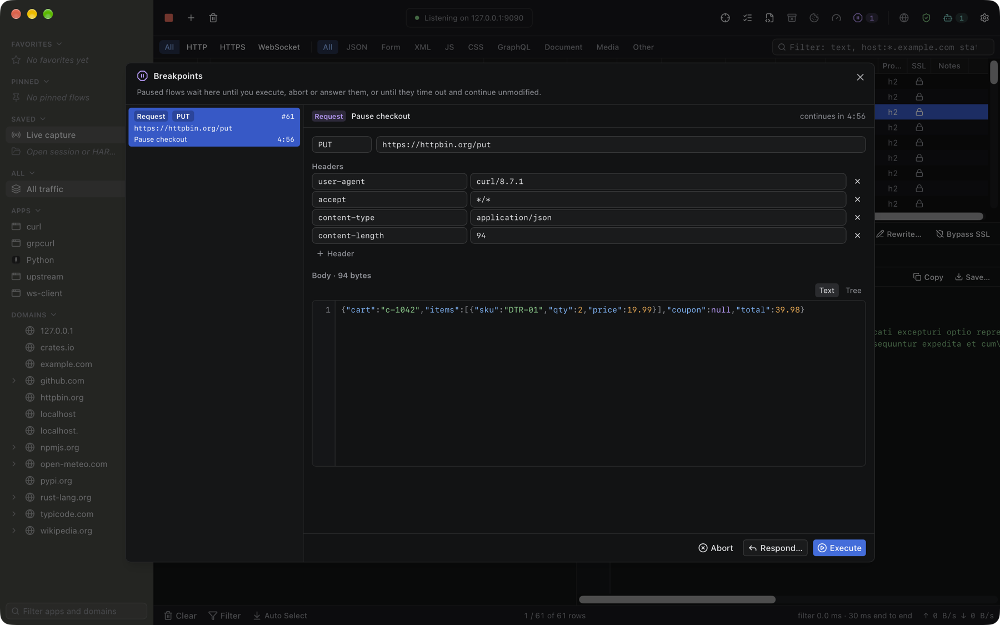</td>
    <td>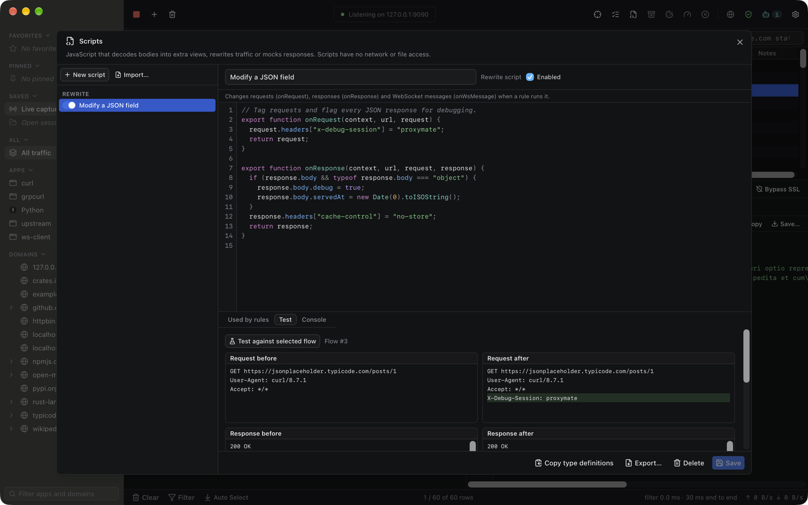</td>
  </tr>
  <tr>
    <td>A request held at a breakpoint</td>
    <td>Scripts, tested against a captured flow</td>
  </tr>
</table>

### Replay, share and mock
- **Replay**, **Edit & Replay**, **Compose** a new request, and **Repeat** one many times with a summary of the results.
- **Copy as** cURL, `fetch`, Python `requests`, HTTPie, Go, Swift, Kotlin or PowerShell.
- **Sessions** save to `.proxymate` files with their pins, labels and comments. **HAR 1.2** imports and exports, and Charles `.chlsj` and `.chlsx` sessions open too.
- **Offline mocking**: serve answers from a recorded session or HAR when the real server is down, or import an OpenAPI spec to label flows by operation and generate mock rules.

### AI agents (MCP)
Proxymate serves the [Model Context Protocol](https://modelcontextprotocol.io) on `127.0.0.1:9095`, so Claude Code, Cursor and other agents can find flows, read bodies, create and test rules and scripts, resolve breakpoints, replay requests and export HAR. That's 44 tools, plus resources and prompts.

- Settings › MCP has the `claude mcp add` line and a JSON config to copy.
- Each install has its own bearer token, and only loopback clients are accepted.
- **Read-only mode** hides every tool that changes anything.
- Rules and scripts an agent creates are tagged with its name, and every call is in an audit log.
- Clients that only speak stdio can run `proxymate mcp-stdio`, which starts the app if it isn't running.

<table>
  <tr>
    <td width="50%">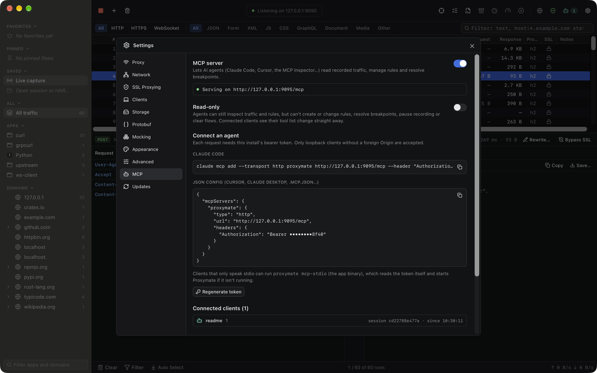</td>
    <td width="50%">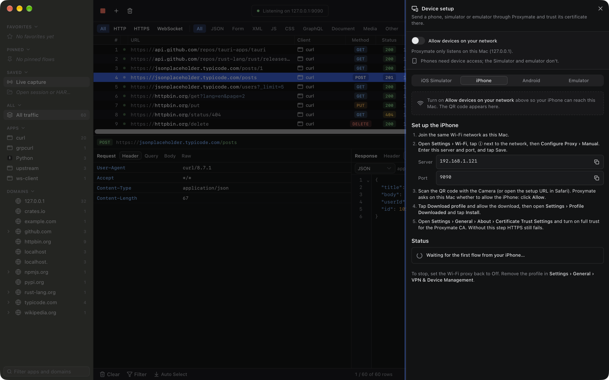</td>
  </tr>
  <tr>
    <td>Connect an agent from Settings › MCP</td>
    <td>Device setup for phones, simulators and emulators</td>
  </tr>
</table>

## Getting started

### Install (macOS)
Download `Proxymate_<version>_universal.dmg` from [Releases](https://github.com/charlie-niekirk/proxymate/releases/latest) and drag Proxymate to Applications. It's a universal app (Apple silicon and Intel) for macOS 13.3 or later.

Releases aren't notarised by Apple yet, so macOS blocks the first launch. Open the app once, then click **Open Anyway** in System Settings › Privacy & Security, or run:

```bash
xattr -dr com.apple.quarantine /Applications/Proxymate.app
```

After that, updates install from inside the app (**Proxymate › Check for Updates…**). Full steps: [`scripts/release/install-notes-macos.md`](scripts/release/install-notes-macos.md).

### First capture
1. Open Proxymate. It listens on `127.0.0.1:9090` (or the next free port up to 9099) and shows the address in the toolbar.
2. Send something through it:

   ```bash
   curl -x http://127.0.0.1:9090 http://example.com/
   ```

3. For HTTPS, open the certificate menu in the toolbar (the shield) and follow the wizard to trust Proxymate's CA. Then turn on the system proxy, or launch a pre-configured browser or terminal from the Intercept menu.

The CA lives in `~/Library/Application Support/Proxymate/ca/`. To use it with curl without trusting it system-wide:

```bash
curl -x http://127.0.0.1:9090 --cacert ~/Library/Application\ Support/Proxymate/ca/proxymate-ca.pem https://example.com/
```

The same port also takes SOCKS5 clients (`curl --socks5-hostname 127.0.0.1:9090 …`).

### Without the app
`proxymate-cli` runs the same engine headless and logs each finished flow. `--mcp` serves MCP alongside it and prints the `claude mcp add` line.

```bash
cargo run -p proxymate-cli -- serve 9090 --mcp
```

## Develop

Requirements:
- Rust: the version pinned in `rust-toolchain.toml` (rustup installs it), edition 2024.
- Node 22 or newer, with npm (workspaces; pnpm isn't used).
- The [Tauri prerequisites](https://v2.tauri.app/start/prerequisites/) for your OS.

```bash
npm install
npm run tauri dev
```

`npm run dev` runs only the UI in a browser at http://localhost:1420, against an in-memory mock backend. Add `?zoo` for a flow of every body type.

Checks (CI runs the same):

```bash
cargo fmt --all && cargo clippy --workspace --all-targets -- -D warnings && cargo test --workspace
```

```bash
npm run typecheck && npm run lint && npm run test && npm run e2e
```

How it's built:

| Path | What it is |
|---|---|
| `crates/pm-core` | The headless engine: proxy, TLS, recording, store, rules, scripts, replay, import and export |
| `crates/pm-model` | The types that cross IPC and MCP (serde + specta) |
| `crates/pm-platform` | OS integration behind traits: keychain, system proxy, process info, launchers |
| `crates/pm-mcp` | The MCP server, an adapter over the engine |
| `crates/pm-testkit` | Test upstreams (HTTP, TLS h1/h2, WebSocket, SSE, gRPC), proxies and the body-viewer zoo |
| `apps/desktop` | The Tauri shell (`src-tauri`) and the React 19 + TypeScript UI (`ui`) |
| `apps/cli` | `proxymate-cli`: headless proxy, MCP stdio bridge, benchmarks and soak tests |

Read [`docs/PLAN.md`](docs/PLAN.md) for the architecture and milestones, and [`CLAUDE.md`](CLAUDE.md) for every command, crate boundary and convention. [`docs/RELEASING.md`](docs/RELEASING.md) covers releases and the updater.

Contributions land through pull requests with green CI; `main` is protected.
